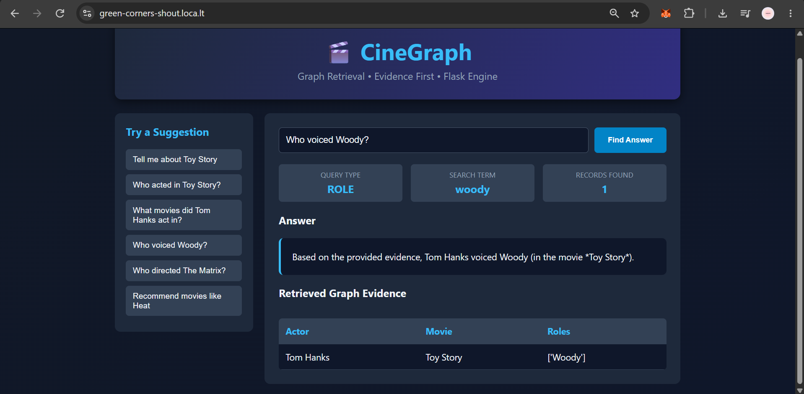
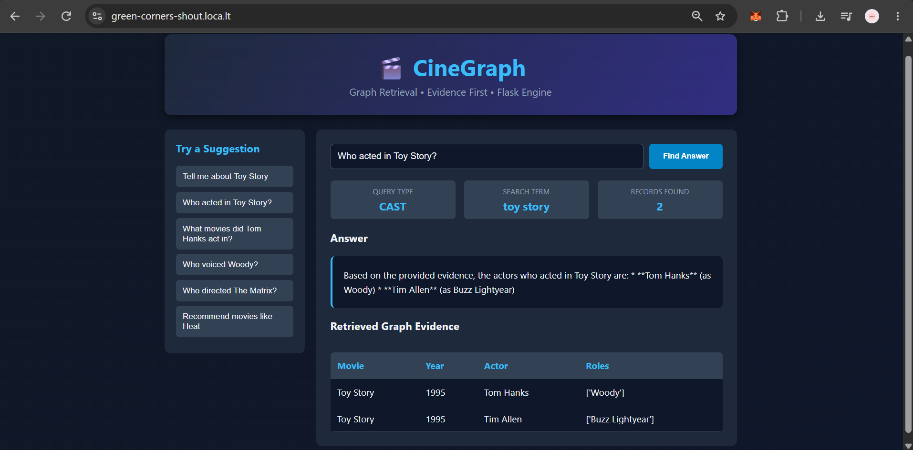
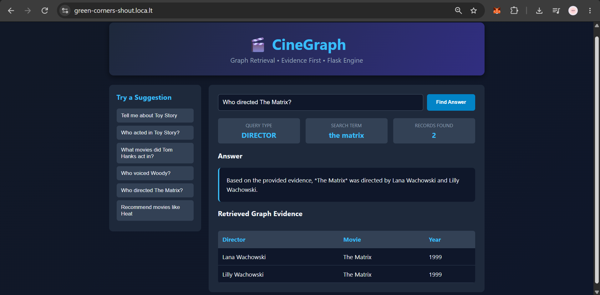

# 🎬 CineGraph — Graph-Based RAG for Movie Question Answering

## Overview

CineGraph is a graph-based Retrieval-Augmented Generation (RAG) application that answers movie-related questions using the Neo4j Movies knowledge graph.

It retrieves relevant information using Cypher queries and uses Google's Gemini LLM to generate natural-language answers grounded in the retrieved graph evidence.

## Features

- Natural-language movie question answering
- Graph-based information retrieval using Neo4j and Cypher
- Query classification to select an appropriate retrieval strategy
- Gemini-powered natural-language answer generation
- Display of retrieved graph evidence alongside the answer
- Flask-based web interface

## Technologies Used

- Python
- Neo4j AuraDB
- Cypher Query Language
- Flask
- Google Gemini API
- Pandas

## Architecture

**Workflow:**

User Question → Query Classification → Cypher Query Execution → Neo4j Knowledge Graph → Retrieved Evidence → Gemini LLM → Answer and Evidence Display

The graph database provides the movie-related evidence used to generate answers. The language model converts the retrieved information into a readable response.

## Demonstrated Queries

### 1. Who voiced Woody?

Retrieves the actor associated with the character Woody in *Toy Story*.



### 2. Who acted in Toy Story?

Retrieves actors and their associated roles in *Toy Story*.



### 3. Who directed The Matrix?

Retrieves the directors associated with *The Matrix*.



## Project Structure

```text
CineGraph-GraphRAG/
├── CINEGRAPH_GITHUB.ipynb
├── app.py
├── README.md
├── requirements.txt
├── .gitignore
├── woody-query.png
├── toy-story-cast.png
└── matrix-director.png
```

## Setup and Installation

### Prerequisites

- Python 3.10 or later
- A Neo4j database containing the Movies graph
- A Google Gemini API key

### 1. Clone the repository

```bash
git clone https://github.com/LAASYA-SD30/CineGraph-GraphRAG.git
cd CineGraph-GraphRAG
```

### 2. Install dependencies

```bash
pip install -r requirements.txt
```

### 3. Configure environment variables

Configure the following environment variables in your local environment or your notebook's secret manager:

- `NEO4J_URI`
- `NEO4J_USERNAME`
- `NEO4J_PASSWORD`
- `GEMINI_API_KEY`

Do not commit credentials to GitHub.

### 4. Run the application

```bash
python app.py
```

Open the local URL printed by Flask in your browser.

## Security

API keys, database passwords, and other credentials must be stored securely using environment variables or a secret manager. Never commit real credentials to the repository.

## Limitations

- Answer quality depends on the information available in the knowledge graph.
- Query classification may not correctly interpret every natural-language question.
- Generated answers depend on the retrieved evidence and the language model's behavior.
- The demonstrated queries do not establish the accuracy of every possible question or recommendation.

## Future Enhancements

- Improved natural-language query interpretation
- More robust movie recommendations
- Expanded graph retrieval and relationship traversal
- Automated evaluation of answer accuracy and evidence relevance
- Improved handling of unsupported questions

## Author

**Laasya S D**

GitHub: [@LAASYA-SD30](https://github.com/LAASYA-SD30)
